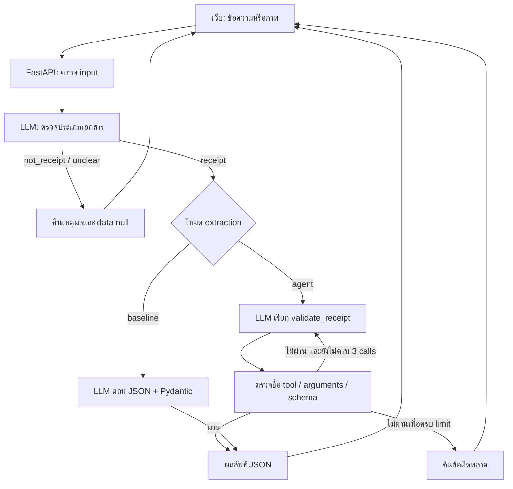

# MessMation

**จากใบเสร็จ เป็นข้อมูลที่ใช้งานต่อได้** — เว็บแปลงข้อความหรือภาพใบเสร็จร้านค้าเป็น JSON จำนวน 5 ฟิลด์ ตรวจด้วย Pydantic และเปรียบเทียบกับเฉลยที่กำหนดไว้

โปรเจกต์รายวิชา Special Topics in Information Technology 3: Building Large Language Model Powered Applications

- Repository: https://github.com/insisapim/MessMation
- Live app: **ยังไม่ได้เผยแพร่ — เพิ่ม URL จริงหลัง deploy และทดสอบบน Render สำเร็จ**
- ผลการทดลองที่บันทึกไว้: ข้อความ 15 ตัวอย่าง + ภาพ 15 ตัวอย่าง; ความถูกต้องรายฟิลด์รวม 85.33% → 90.67% เมื่อใช้ agent ในการทดลองครั้งนี้

## ปัญหาและผู้ใช้

ผู้ที่ต้องนำข้อมูลจากใบเสร็จไปใส่ตารางหรือระบบอื่นต้องอ่านและพิมพ์ข้อมูลซ้ำ MessMation ช่วยจัดข้อมูลให้พร้อมคัดลอกหรือดาวน์โหลดเป็น JSON โดยผู้ใช้ยังต้องตรวจเทียบกับต้นฉบับ เหมาะสำหรับสาธิตการจัดข้อมูลใบเสร็จของร้านค้า ร้านอาหาร และร้านกาแฟ

ระบบรองรับข้อความและภาพ JPG/PNG/WebP ตรวจประเภทเอกสารก่อนแปลงข้อมูล และตอบ `not_receipt` หรือ `unclear` พร้อม `data: null` เมื่อไม่ควรแปลง ระบบไม่ได้ตรวจความแท้ของเอกสารหรือรับรองความถูกต้องทางบัญชี

## เริ่มใช้งานบน Windows / PowerShell

ต้องมี Python 3.12, Git และ API key/base URL ของ class proxy ที่รองรับ `gemma-4-E4B-it`, ภาพ และ native function calling

```powershell
git clone https://github.com/insisapim/MessMation.git
cd MessMation
py -3.12 -m venv .venv
.\.venv\Scripts\python.exe -m pip install -r requirements.txt
Copy-Item .env.example .env
```

แก้ `.env` ใส่ key และ URL ที่ได้รับจากรายวิชา:

```dotenv
OPENAI_API_KEY=ใส่คีย์ของคุณ
OPENAI_BASE_URL=ใส่_URL_class_proxy_ที่ลงท้ายด้วย_/v1
MESSMATION_AGENT=true
MESSMATION_DEMO=false
```

จากนั้นรัน:

```powershell
.\.venv\Scripts\python.exe -m uvicorn main:app --reload
```

เปิด http://127.0.0.1:8000 — เลือกข้อความหรือภาพ กด **แปลงข้อมูล** ตรวจผล แล้วคัดลอก/ดาวน์โหลด JSON; API docs อยู่ที่ http://127.0.0.1:8000/docs

บน macOS/Linux ใช้ `python3.12 -m venv .venv`, `source .venv/bin/activate`, `pip install -r requirements.txt`, `cp .env.example .env` แล้ว `uvicorn main:app --reload`

### Environment

| ตัวแปร | ความหมาย |
|---|---|
| `OPENAI_API_KEY` | key ของ class proxy; เก็บเฉพาะฝั่งเซิร์ฟเวอร์ |
| `OPENAI_BASE_URL` | URL ของ class proxy ตามที่รายวิชาให้ |
| `MESSMATION_AGENT` | `true`: ใช้ validation tool loop; `false`: direct extraction baseline |
| `MESSMATION_DEMO` | `true`: จำลองผลเฉพาะหน้าเว็บโดยไม่เรียกโมเดล; ต้องเป็น `false` ใน evaluation และ live submission |

`load_dotenv()` ไม่ทับ environment ที่มีอยู่แล้ว การเปลี่ยนตัวแปรใน PowerShell ต้องทำในหน้าต่างที่เปิดเซิร์ฟเวอร์ แล้ว restart เซิร์ฟเวอร์ ค่าเริ่มต้นในโค้ดของ flags คือ `false`; `.env.example` และ `render.yaml` ตั้ง agent เป็น `true` อย่างชัดเจน

`requirements.txt` ล็อก dependency ที่ติดตั้งและทดสอบการทำงานภายในเครื่องในชุดเตรียม deploy นี้ ไม่ใช่หลักฐานเวอร์ชันแพ็กเกจที่ใช้สร้างผล evaluation เดิม เพราะ ZIP ต้นทางไม่มี dependency lock

## ข้อมูลผลลัพธ์

ตัวอย่างโครงสร้าง (ข้อมูลประกอบคำอธิบาย):

```json
{
  "document_type": "receipt",
  "reason": "เป็นใบเสร็จรับเงินจากร้านค้า",
  "data": {
    "merchant_name": "ร้านตัวอย่าง",
    "receipt_date": "2026-10-24",
    "total": 135.0,
    "currency": "THB",
    "receipt_number": "MM-001"
  }
}
```

| ฟิลด์ | รูปแบบ |
|---|---|
| `merchant_name` | ชื่อผู้ขายตามต้นฉบับ หรือ `null` |
| `receipt_date` | วันที่จริงในรูปแบบ ค.ศ. `YYYY-MM-DD` หรือ `null` |
| `total` | จำนวนเงินสุทธิที่ไม่ติดลบและเป็น finite number หรือ `null` |
| `currency` | ตัวอักษรใหญ่ 3 ตัว เช่น `THB` หรือ `null` |
| `receipt_number` | หมายเลขใบเสร็จ/เอกสารตามต้นฉบับ หรือ `null` |

ทุกฟิลด์จำเป็นต้องมี แต่รับ `null` ได้; ห้าม extra keys การผ่าน schema ไม่ได้พิสูจน์ว่าข้อมูลตรงกับใบเสร็จ และ regex สกุลเงินไม่ได้ตรวจทะเบียน ISO ทั้งหมด

## สถาปัตยกรรมและเทคนิค



- **Structured output:** prompt กำหนด 5 ฟิลด์และนโยบาย `null`; Pydantic ตรวจชนิดข้อมูล วันที่ ยอดเงิน และ extra keys
- **Agentic tools:** native function calling; อนุญาตเฉพาะ `validate_receipt`; ตรวจ arguments; ส่งผลที่ไม่ผ่านกลับให้โมเดล; จำกัดสูงสุด 3 model calls ใน extraction loop (ไม่รวมการเรียกตรวจประเภทเอกสาร 1 ครั้ง)
- **Evaluation:** เปรียบเทียบ baseline และ agent ด้วยเฉลย 30 ตัวอย่าง ตามขอบเขต extraction evaluation ที่ผู้จัดทำยืนยันกับผู้สอน
- **Served interface:** FastAPI + HTML/CSS/JavaScript; POST + SSE ส่งสถานะขั้นตอนและผลลัพธ์ ไม่ใช่การสตรีม token หรือ chain-of-thought

`main.py` รับ HTTP/ตรวจ input, `pipeline.py` จัดลำดับงานและ event, `llm.py` เก็บ prompt/การเรียก class proxy, `receipt_agent.py` ควบคุม loop, `receipt_tools.py` ตรวจข้อมูล, `schemas.py` กำหนด schema

ทั้งสองโหมดใช้ `gemma-4-E4B-it`, temperature 0, timeout 60 วินาทีต่อ model call และปิด SDK retry; baseline ใช้ max_tokens 500 สำหรับ extraction ส่วน agent ใช้ 1000 พร้อม tool instructions จึงเป็นการเปรียบเทียบสอง pipeline ไม่ใช่การแยกผลของ retry อย่างเดียว

สำหรับข้อความ validator ตรวจหลักฐานจำนวนเงินที่ระบุบาทร่วมด้วยเมื่อไม่มีสัญญาณสกุลเงินอื่น กฎนี้ยังไม่ตรวจจากภาพและไม่ได้ตรวจความถูกต้องทุกฟิลด์ ไม่มี OCR engine, RAG หรือฐานข้อมูลแยกต่างหาก

เว็บแสดง progress ที่ได้รับจาก pipeline; รายละเอียด tool call แต่ละรอบยังแสดงใน server console ไม่ได้ส่งทั้งหมดมายังหน้าเว็บ

## API

| Method / path | รายละเอียด |
|---|---|
| `GET /` | หน้าเว็บ |
| `GET /healthz` | ตรวจว่า process ตอบได้; ไม่เรียกหรือยืนยันว่า AI พร้อมใช้งาน |
| `POST /api/extract` | multipart form: `mode=text` + `text` หรือ `mode=image` + `image`; JSON response |
| `POST /api/extract/stream` | input เดียวกัน; SSE events `progress`, `result`, `error`, `done` |

ข้อความไม่เกิน 12,000 ตัวอักษร ภาพไม่เกิน 5 MiB และ 20 ล้านพิกเซล มีการตรวจชนิดไฟล์จากเนื้อภาพด้วย Pillow

```powershell
curl.exe -sS -F "mode=text" -F "text=ร้านทดสอบ ใบเสร็จ ยอดสุทธิ 120 บาท" http://127.0.0.1:8000/api/extract
```

HTTP 200 + `not_receipt` เป็นการจำแนกเอกสารสำเร็จ ส่วน SSE ที่เริ่มส่งแล้วอาจแจ้งความล้มเหลวผ่าน event `error` จึงต้องตรวจ event ด้วย ไม่ใช่ดู HTTP status อย่างเดียว

## ชุดข้อมูลและวิธีประเมิน

- Development: `eval/dev.jsonl` 10 ข้อความ และ `eval/dev-images.jsonl` 4 ภาพ ใช้ระหว่างปรับ prompt/กฎ
- Test: `eval/test-text.jsonl` 15 ข้อความสังเคราะห์โดยใช้ AI ช่วยจัดทำ และ `eval/test-images.jsonl` 15 ภาพจากตัวอย่าง/แม่แบบใบเสร็จออนไลน์ พร้อมเฉลยที่ผู้จัดทำยืนยันก่อนการเปรียบเทียบที่รายงาน
- เก็บ raw images ไว้ใน `eval/images/`; source URLs และแนวทางกำหนดเฉลยอยู่ใน [dataset-notes](eval/dataset-notes.md)
- ไม่รวมภาพ 006 ซึ่งไม่ชัด และภาพ 015 Cash App ซึ่งเป็นกรณีเอกสารนอกขอบเขต ใน test extraction 30 ตัวอย่าง

**Baseline:** `MESSMATION_AGENT=false` ตรวจประเภทเอกสารแล้วเรียก extraction โดยตรง ตรวจ schema ครั้งเดียว ไม่มี tool repair loop แต่ใช้ prompt ที่ปรับบน dev แล้ว จึงไม่ใช่ prompt รุ่นแรก

**Agent:** `MESSMATION_AGENT=true` ใช้ classifier เดียวกัน แล้วเปิด validation tool loop และกฎใน tool

Metrics ของ `evaluate.py`:

- Schema valid rate: สัดส่วนตัวอย่างที่ API ส่งใบเสร็จซึ่ง `data` ผ่าน `ReceiptData`
- Field accuracy: จำนวนฟิลด์ที่เท่ากับ gold ÷ (จำนวนตัวอย่าง × 5)
- Document exact match: สัดส่วนเอกสารที่ถูกครบทั้ง 5 ฟิลด์
- Present/null field accuracy: แยกตัวหารตาม gold ที่มีค่าและเป็น `null`
- เวลาเฉลี่ย: เวลาต่อคำขอรวม network และ pipeline

สคริปต์เทียบค่าหลัง Pydantic parse ด้วย `==` ไม่มี fuzzy match ชื่อร้าน/เครื่องหมาย/หมายเลขต้องตรงกัน หาก request ผิดพลาดหรือ schema ไม่ผ่าน นับทั้ง 5 ฟิลด์เป็นผิด

### ทำซ้ำการทดลอง

เปิดสอง terminal ที่ root โปรเจกต์ โดย **Terminal A รันเซิร์ฟเวอร์**:

```powershell
$env:MESSMATION_DEMO = "false"
$env:MESSMATION_AGENT = "false"
.\.venv\Scripts\python.exe -m uvicorn main:app
```

ใน **Terminal B**:

```powershell
.\.venv\Scripts\python.exe evaluate.py eval/test-text.jsonl
.\.venv\Scripts\python.exe evaluate.py eval/test-images.jsonl
```

เก็บผลสองไฟล์เป็น baseline จากนั้นหยุดเซิร์ฟเวอร์ด้วย Ctrl+C ใน Terminal A แล้วเปิด agent:

```powershell
$env:MESSMATION_AGENT = "true"
.\.venv\Scripts\python.exe -m uvicorn main:app
```

รันคำสั่ง Terminal B อีกครั้ง บันทึกว่าไฟล์ใดเป็น baseline/agent เพราะ output เดิมไม่ได้ฝัง flag นี้โดยอัตโนมัติ ผลจะอยู่ที่ `eval/results/<dataset>-<timestamp>.json` โดยไม่ทับไฟล์เก่า การรันใหม่ใช้บริการ AI จริงและอาจได้ผลต่างออกไปแม้ temperature เป็น 0; client ใน evaluate.py รอได้ 150 วินาที ซึ่งอาจสั้นกว่าผลรวม timeout ของ classifier และ agent หลายรอบ

ใช้ `--url https://YOUR-ACTUAL-HOST/api/extract` เพื่อประเมิน deployment ได้ แต่ตัวเลขที่รายงานด้านล่างเป็นผลจาก localhost ไม่ใช่ performance บน Render

### ผลที่บันทึกไว้

| ชุด / โหมด | จำนวน | Schema valid | Field accuracy | Document exact match | เวลาเฉลี่ย (วินาที) |
|---|---:|---:|---:|---:|---:|
| ข้อความ / baseline | 15 | 100% | 97.33% (73/75) | 86.67% (13/15) | 1.546 |
| ข้อความ / agent | 15 | 100% | 98.67% (74/75) | 93.33% (14/15) | 1.610 |
| ภาพ / baseline | 15 | 86.67% | 73.33% (55/75) | 33.33% (5/15) | 1.835 |
| ภาพ / agent | 15 | 100% | 82.67% (62/75) | 33.33% (5/15) | 1.642 |
| รวม / baseline | 30 | 93.33% (28/30) | 85.33% (128/150) | 60.00% (18/30) | 1.690 |
| รวม / agent | 30 | 100% (30/30) | 90.67% (136/150) | 63.33% (19/30) | 1.626 |

ไฟล์หลักฐาน (การระบุ baseline/agent ตามการตั้งค่าที่ผู้จัดทำรายงานขณะรัน):

| โหมด | ข้อความ | ภาพ |
|---|---|---|
| Baseline | [022122](eval/results/test-text-20261024-022122-795948.json) | [022151](eval/results/test-images-20261024-022151-100668.json) |
| Agent | [022327](eval/results/test-text-20261024-022327-705274.json) | [022356](eval/results/test-images-20261024-022356-956713.json) |

**สิ่งที่ผลบอกได้:** field accuracy รวมดีขึ้น 5.33 percentage points ในการทดลองครั้งนี้ แต่ภาพยังมี document exact match เท่าเดิม 5/15 ตัวอย่าง 7 จาก 8 ฟิลด์ที่เพิ่มสุทธิมาจากภาพ 013 และ 017 ซึ่ง baseline เคยตอบ HTTP 502 และถูกให้คะแนนศูนย์; logs ชุดผลนี้ไม่ยืนยันว่า agent retry กี่รอบ จึงไม่อ้างว่าทั้งหมดดีขึ้นเพราะการ repair

### ข้อผิดพลาดและข้อจำกัด

- `test-text-014`: gold วันที่เป็น `null` แต่โมเดลเลือกวันที่จากรูปแบบที่กำกวม
- `test-image-001`: นำเลข transaction มาเป็น receipt number ทั้งที่ gold เป็น `null`
- `test-image-002`: baseline ตอบครบถูก แต่ agent เดาสกุลเงิน USD จากหลักฐานที่ gold ถือว่ากำกวม
- `test-image-005`: ใช้ subtotal แทนยอดสุทธิที่ไม่ปรากฏ
- ชื่อร้าน/สาขา/เครื่องหมายวรรคตอนใช้ strict equality จึงรวมความต่างเชิงรูปแบบไว้ในคะแนนผิดด้วย
- ชุดข้อมูลเล็ก มีภาพแม่แบบออนไลน์หลายภาพจากแหล่งเดียวกัน ไม่แทนใบเสร็จจริงทุกสภาพ และรันเพียงหนึ่งครั้งต่อโหมด ไม่สรุปความแตกต่างด้านความเร็วหรือนัยสำคัญทางสถิติ
- gold บางภาพ dev เคยถูกแก้จากการอ่านต้นฉบับผิด ผล dev เก่าจึงเป็นประวัติการพัฒนา ไม่ใช่ตัวเลข final test
- การประมวลผลพึ่งพา class proxy; อาจ timeout, ไม่พร้อมใช้งาน หรือผลไม่คงที่
- ไม่มีระบบบัญชีผู้ใช้ rate limiting หรือประวัติเอกสารถาวร เป็น capstone demo; ก่อนขยายสู่บริการสาธารณะควรเพิ่มการจำกัดการใช้งานและประเมินโหลด

แนวทางต่อไป: เพิ่มภาพจริงและภาพคุณภาพต่ำ ทดสอบซ้ำหลายรอบ เพิ่มเอกสารนอกขอบเขตเพื่อวัด classification แยก และเก็บ metadata ของ model/prompt/flags/tool calls ทุก run โดยใช้ dev สำหรับปรับระบบ

## การทดสอบกลไกและเอกสารนอกขอบเขต

ไม่ต้องเปิดเซิร์ฟเวอร์ และไม่เรียก AI:

```powershell
.\.venv\Scripts\python.exe receipt_tools.py
.\.venv\Scripts\python.exe -m unittest test_receipt_agent test_web -v
```

`test_receipt_agent.py` จำลองคำตอบโมเดล แต่ใช้ agent loop และ validator จริง: ตรวจ feedback → สำเร็จรอบสอง และหยุดเมื่อครบ 3 calls ไม่ใช่การวัด LLM repair rate จริง `test_web.py` ตรวจ HTTP/static assets/validation/SSE ด้วยข้อมูลจำลอง

ตรวจ native tool calling กับ class proxy จริง (ต้องตั้งค่า key):

```powershell
.\.venv\Scripts\python.exe check_tool_support.py
```

ผู้จัดทำเคยยืนยัน native tool round trip สำเร็จ และเก็บผล control-flow tests ใน [agent-control-tests.txt](eval/results/agent-control-tests.txt)

กรณี Cash App ที่รันทดสอบจริง:

```powershell
curl.exe -sS -o .\eval\results\cashapp-rejection.json -w "HTTP status: %{http_code}\n" -F "mode=image" -F "image=@eval/images/test/dev-images-015.png" http://127.0.0.1:8000/api/extract
```

ผลที่เก็บไว้: HTTP 200, `document_type: not_receipt`, `data: null` — [หลักฐาน](eval/results/cashapp-rejection.json) นี่เป็นการปฏิเสธเอกสารถูกต้องเพียงหนึ่งกรณี ไม่ใช่ failure case และยังไม่ใช่ classification accuracy ของชุดข้อมูล

## Deploy บน Render

เลือก **New → Web Service** แล้วเชื่อม GitHub repository นี้ ตั้งค่า:

| ช่อง | ค่า |
|---|---|
| Language | Python 3 |
| Root Directory | เว้นว่าง ถ้า `main.py` อยู่ root ของ repo |
| Build Command | `pip install -r requirements.txt` |
| Start Command | `uvicorn main:app --host 0.0.0.0 --port $PORT` |
| Health Check Path | `/healthz` |
| Python version | `.python-version` กำหนดสาย 3.12 |

เพิ่ม `OPENAI_API_KEY`, `OPENAI_BASE_URL` ใน Environment ของ Render; ตั้ง `MESSMATION_AGENT=true`, `MESSMATION_DEMO=false` แล้ว deploy ไม่มี `.env` บน host ก็ทำงานได้

อีกทางเลือกคือ **New → Blueprint** แล้วเลือก repo เพื่อใช้ [render.yaml](render.yaml) ซึ่งเตรียมค่าเดียวกันไว้และให้กรอก secrets ภายหลัง ไม่ต้องใช้ทั้งสองวิธีพร้อมกัน

หลัง deploy ตรวจ `/healthz`, หน้าเว็บ, CSS/JS/font, ข้อความจริง, ภาพจริง, SSE progress, copy/download และกรณี non-receipt จาก URL บน Render; health check ผ่านอย่างเดียวไม่ยืนยันว่า class proxy เข้าถึงได้จาก Render

Free instance พักหลังไม่มี traffic 15 นาทีและต้องตื่นเมื่อมี request จึงเปิดเว็บก่อนสาธิต ข้อมูลที่เขียนบน filesystem ของ free service ไม่ใช่ที่เก็บถาวร แอปนี้ไม่บันทึกใบเสร็จที่อัปโหลดลงดิสก์เอง

อ้างอิง: [FastAPI deployment](https://render.com/docs/deploy-fastapi), [Python version](https://render.com/docs/python-version), [Free services](https://render.com/docs/free), [Blueprint specification](https://render.com/docs/blueprint-spec)

## Demo และส่งงาน

ส่ง public GitHub URL, รายงาน PDF 4–8 หน้า และ URL live app ที่ทำงานจริง (ทางเลือกแทนวิดีโอ 3–6 นาทีตามโจทย์) เพิ่ม live URL ด้านบนหลังทดสอบเสร็จ

เตรียมแสดงข้อความ/ภาพจริงหนึ่งกรณีที่ถูกต้อง และกรณีที่อ่านค่าผิดจริงจากหัวข้อ error analysis อธิบาย gold เทียบ prediction ไม่รับประกันว่ารันใหม่จะผิดตรงเดิม; เปิดไฟล์ผลที่บันทึกไว้ประกอบอย่างชัดเจน ไม่จำลอง failure แล้วอ้างเป็นผลจริง พร้อมรับ input ใหม่ในการสอบสาธิต

โครงสร้างหลัก:

```text
MessMation/
  main.py, pipeline.py, llm.py
  schemas.py, receipt_agent.py, receipt_tools.py
  web/                         HTML / CSS / JS / self-hosted fonts
  eval/                        datasets / source images / results
  evaluate.py
  check_tool_support.py
  test_receipt_agent.py, test_web.py
  requirements.txt, .python-version, .env.example, render.yaml
  docs/                        deployment verification notes
```

## เครดิตและข้อมูลส่วนบุคคล

ใช้แนวทางจากสไลด์รายวิชาและ reference app `kmitl-llm-app-demo` ในเรื่อง FastAPI/SSE/schema/evaluation/agent loop โดยเปลี่ยนงานเป็นการแปลงใบเสร็จและใช้ corpus/evaluation ของโปรเจกต์ มีการใช้ ChatGPT ช่วยพัฒนาโค้ด ออกแบบ UI เขียนเอกสาร และสร้างข้อมูลข้อความสังเคราะห์ ผู้จัดทำเป็นผู้รันและตรวจผลการทดลอง

ภาพตัวอย่างออนไลน์เป็นของแหล่งต้นทาง ไม่ได้อ้างสิทธิ์หรือใบอนุญาตครอบคลุมภาพเหล่านั้น ดู URL แหล่งข้อมูลใน `eval/dataset-notes.md` ฟอนต์ Noto Sans Thai จาก Google Fonts ใช้ SIL Open Font License และเก็บใบอนุญาตไว้ใน `web/fonts/OFL.txt`

ข้อมูลข้อความ/ภาพถูกส่งไปบริการ LLM ที่กำหนดใน `OPENAI_BASE_URL`; เว็บไม่มีระบบเก็บประวัติถาวร แต่ไม่ได้รับรองนโยบายการเก็บข้อมูลของผู้ให้บริการปลายทาง ใช้ข้อมูลตัวอย่างที่เหมาะสมกับการสาธิต และห้าม commit API key หรือ `.env`
